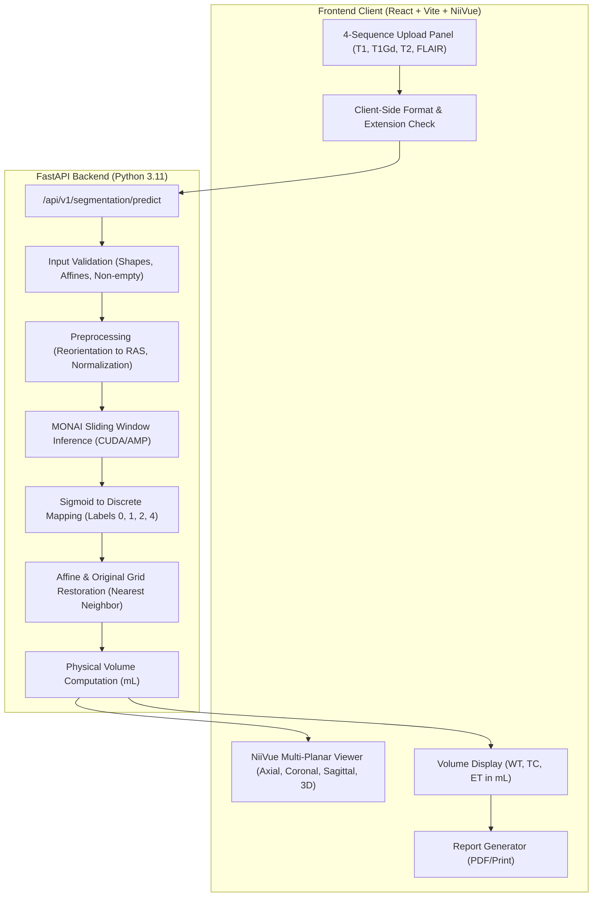

# System Architecture & Technical Specifications

This document outlines the end-to-end data pipeline, component responsibilities, and planned API contracts for **NeuroScope-3D**.

---

## 1. High-Level Data Flow



---

## 2. Component Responsibilities

### A. Frontend Tier (`frontend/`)
- **Technology**: React 19, Vite, Tailwind CSS, Lucide React, NiiVue.
- **Responsibilities**:
  1. **Upload & File Handling**: Drag-and-drop or file pickers for the 4 required sequences.
  2. **Client Validation**: Verifies that files have valid `.nii` or `.nii.gz` extensions and non-zero byte size before dispatching to the API.
  3. **Multi-Planar Rendering**: Instantiates NiiVue WebGL2 canvas displaying linked axial, coronal, and sagittal viewports with crosshairs and opacity sliders.
  4. **Volume Dashboard**: Visual cards showing calculated volumes for WT, TC, and ET in millilitres.
  5. **Report Export**: Formats an executive clinical decision-support summary with patient ID, sequence metadata, volumes, and slice snapshots.

### B. Backend Tier (`backend/`)
- **Technology**: FastAPI, Uvicorn, Python 3.11, Pydantic, NiBabel, NumPy, SciPy.
- **Responsibilities**:
  1. **API Router**: Async endpoint receiving multipart form data.
  2. **Validation Engine**:
     - Loads NIfTI headers via NiBabel.
     - Confirms 3D spatial dimensions match across all 4 sequences ($H \times W \times D$).
     - Confirms affine matrices are compatible (co-registered scans).
  3. **Preprocessing Pipeline**:
     - Reorients to standard orientation (`RAS`).
     - Applies intensity normalization (z-score on brain voxels).
  4. **Inference Pipeline**:
     - Pretrained MONAI 3D SegResNet model.
     - Sliding window inference (`roi_size=(128, 128, 128)` or `(96, 96, 96)`, `sw_batch_size=1`, mixed precision `fp16`) to stay within 6 GB VRAM limits.
  5. **Postprocessing & Discrete Reconstruction**:
     - Converts 3-channel sigmoid outputs into discrete BraTS 2021 labels (`0, 1, 2, 4`).
  6. **Spatial Geometry Restoration**:
     - Inverts spatial transforms to resample the predicted mask back to the raw input dimensions and affine geometry.
  7. **Volumetric Calculator**:
     - Computes exact volume in mL for WT, TC, and ET using the voxel dimensions extracted from the affine matrix.

---

## 3. Planned API Contract

### Endpoint: `POST /api/v1/segment/predict`
Accepts 4 multipart files (`t1`, `t1gd`, `t2`, `flair`).

#### Request Parameters (Multipart Form-Data):
- `t1`: File (`.nii` or `.nii.gz`) - Required
- `t1gd`: File (`.nii` or `.nii.gz`) - Required
- `t2`: File (`.nii` or `.nii.gz`) - Required
- `flair`: File (`.nii` or `.nii.gz`) - Required
- `patient_id`: String (Optional, default: `"ANONYMOUS"`)

#### Response Payload (JSON):
```json
{
  "status": "success",
  "patient_id": "BraTS2021_00001",
  "execution_time_seconds": 4.82,
  "hardware_device": "NVIDIA GeForce RTX 3050 Laptop GPU",
  "original_geometry": {
    "dimensions": [240, 240, 155],
    "voxel_spacing_mm": [1.0, 1.0, 1.0],
    "orientation": "RAS"
  },
  "volumes_ml": {
    "whole_tumor": 42.15,
    "tumor_core": 18.30,
    "enhancing_tumor": 9.45,
    "edema": 23.85,
    "necrotic_core": 8.85
  },
  "metrics": {
    "voxel_counts": {
      "wt_voxels": 42150,
      "tc_voxels": 18300,
      "et_voxels": 9450,
      "ed_voxels": 23850,
      "netc_voxels": 8850
    }
  },
  "artifacts": {
    "segmentation_mask_url": "/api/v1/artifacts/BraTS2021_00001_seg.nii.gz",
    "report_summary_url": "/api/v1/artifacts/BraTS2021_00001_report.json"
  }
}
```

#### Error Handling Contract (RFC 7807):
```json
{
  "error": "INCOMPATIBLE_SPATIAL_DIMENSIONS",
  "message": "Sequence dimensions do not match. T1 is [240, 240, 155] but T2 is [256, 256, 176].",
  "detail": {
    "t1_shape": [240, 240, 155],
    "t2_shape": [256, 256, 176]
  }
}
```
